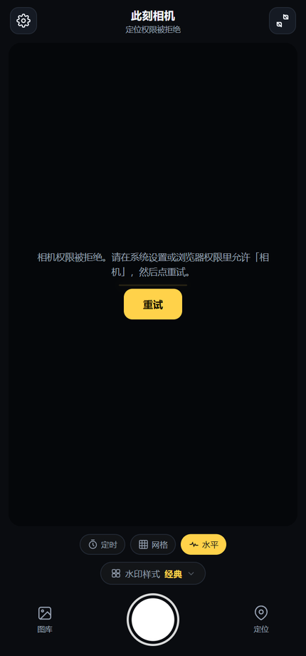
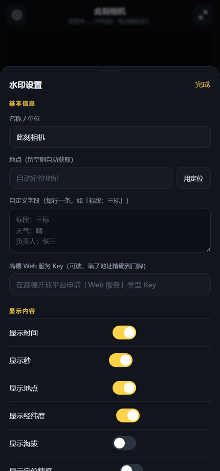
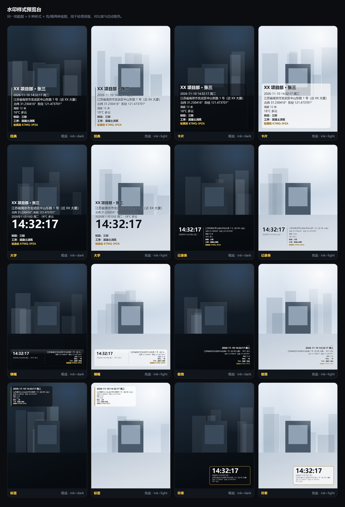

# 此刻相机 · Moment Camera

一个**能自证清白**的水印相机：拍照自动叠加时间、地点、经纬度、天气等信息，并把照片指纹、拍摄信息用 ECDSA 签进图像文件。任何人拿到原图，都能在离线状态下验证「这张图是什么时候、在哪拍的，且没有被改过」。

Android APK 与网页版同源，全部逻辑在 `www/` 目录里，无框架、无构建、无第三方运行时依赖。

<p align="center">
  
  
</p>

<p align="center">
  
</p>

---

## 它解决什么问题

市面上的水印相机大多有三类毛病：

1. **水印只是画上去的**——图片内容本身可以随便改，水印不能作为任何凭证；
2. **信息出不了 App**——时间地点只在画面上有，文件里没有 EXIF，一到相册、微信、甲方系统里就丢了；
3. **拍得难看**——成片用的是预览帧，分辨率低、手一抖就糊，水印压在雪地白墙上根本看不见。

这个项目针对性地做了三件事：**写入标准 EXIF**、**数字签名 + 离线验真**、**拍摄链路与成像质量优化**。

## 功能

**拍摄**
- 优先 `ImageCapture` 取原生满幅照片，失败自动退预览帧，不影响出片
- 连取 3 帧算拉普拉斯方差取最清晰一张，抵消手抖与虚焦
- 预览所见即成片所得：前置镜像、双指变焦、比例裁切全部统一映射
- 触控对焦、曝光补偿、补光灯、定时拍摄、九宫格、水平仪
- 物理多摄识别：能区分广角/主摄/长焦的机型可直接切换真光学镜头，否则退传感器变焦或画面裁切

**水印**
- 8 种样式：经典 / 卡片 / 大字 / 记录条 / 横幅 / 极简 / 标签 / 印章
- 自动取色：采样水印区域亮度，浅色画面自动切深色墨水，深色画面用白字
- 位置三档（左下 / 右下 / 顶部）、字号三档、自定义字段（最多 8 条）
- 内容超过画面高度时自动等比收缩，不会溢出

**信息与凭证**
- 标准 EXIF：`DateTimeOriginal`、GPS（度分秒 + 海拔 + UTC 时间）、`Make`/`Model`/`Software`
- 中文写入 `UserComment`(UNICODE) 与 `XPTitle`/`XPComment`，资源管理器与系统相册可读
- 每张照片生成 8 位「验真码」，可用肉眼核对
- ECDSA P-256 签名落在 JPEG `APP15` 段，含公钥与哈希，离线可验
- 验真页 `verify.html`：拖入图片即可判断「有效 / 被改动 / 伪造 / 签名者未受信」

**其他**
- 相册导入加印：自动读取原图 EXIF 时间与 GPS，没有则用当前定位
- 图库：本次拍摄历史、批量保存、改水印重出图
- 定位反查三级兜底：高德（需 Key）→ OpenStreetMap → BigDataCloud
- 天气来自 Open-Meteo，免 Key

## 目录结构

```
www/                 前端（业务代码全在这里）
  index.html
  app.js             相机控制 + 拍摄流水线 + UI
  styles.css
  js/wm-core.js      水印渲染引擎（纯函数，8 种样式）
  js/exif-write.js   标准 EXIF 写入
  js/exif.js         EXIF 读取
  js/crypto-wmc.js   密钥、签名、JPEG 签名段
  js/verify.js       验真页逻辑
  js/native.js       Android WebView 桥接
  verify.html        验真页
shell/               WebView 壳（不参与日常开发）
  AndroidManifest.xml  classes.dex  resources.arsc  res/
build/               打包脚本
  build_apk.py       重打包 + 对齐 + 签名（不需要 Android SDK）
  SignApk.java       apksig 签名 / 验签
tests/               自动化测试
tools/preview.html   水印样式预览台
docs/                调研、变更记录、截图
```

## 快速开始

**网页版**（Chrome/Edge，需 HTTPS 或 localhost 才能用摄像头）

```bash
cd www && python -m http.server 8080
# 浏览器打开 http://localhost:8080
```

**打 APK**（只需要 JDK 17+ 与 Python 3.9+，不需要 Android SDK）

```bash
python build/build_apk.py                    # 自动生成密钥、打包、签名、自检
python build/build_apk.py --version 5 --name 1.4.0
python build/build_apk.py --no-sign          # 只出未签名包
```

产物在 `build/此刻相机-<版本>.apk`。签名密钥生成在 `build/wmc.keystore`，**已被 gitignore，务必备份**：丢了就无法覆盖安装升级。

## 测试

```bash
node tests/test-exif.js        # EXIF 写入 → 读取 往返（11 项）
node tests/test-layout.js      # 8 样式 × 3 尺寸 × 3 位置 × 3 字号 = 216 组排版（重叠/越界）
                               #  + 24 组缩放一致性（字号必须随画布宽度等比变化）
PW_PATH=<playwright-core 路径> node tests/e2e-capture.js   # 假摄像头真实拍摄 + 验真页闭环（16 项）
```

`e2e-capture.js` 用 Chromium 的 `--use-fake-device-for-media-stream` 走完整链路：按快门 → 取图 → 水印 → EXIF → 签名 → 预览，然后把成片取出来，在 Node 里独立解析 EXIF、校验哈希、验签，并把图片喂给验真页确认判定结果。

## 验证原理

```
照片字节 ──SHA-256──► imh（图片哈希）
                        │
ts / lat / lng / addr ──┴──► 签名原文 ──ECDSA P-256──► sig
                                                        │
JPEG:  SOI │ APP1 EXIF │ ... │ APP15 {core, code, imh, sig, pub, fp} │ 图像数据
```

验签时：把 APP15 段摘掉重新算哈希 → 与 `imh` 比对（判断图有没有被改）；再用 `pub` 验证 `sig`（判断签名是不是伪造的）。签名私钥只存在于拍摄设备的 IndexedDB 中，不上传、不联网。

**边界要说清**：这套签名证明「文件自签发起未被修改」，以及「拍摄时间/坐标是签名者声称的」。它不能证明拍摄者没有在拍照前伪造信息。要用于正式取证，还需配合可信时间戳或第三方存证。

## 兼容性

- Android 7.0+（`minSdk 24`，`targetSdk 34`）
- 相机与定位在 WebView 内走 `getUserMedia` / `geolocation`，需要的权限已在 manifest 声明
- 网页版建议 Chrome 90+ / Edge 90+；iOS Safari 不支持 `ImageCapture`，会自动退到预览帧路径
- 反查地址、天气需要联网；断网时拍出的照片仍然带时间与坐标，只是没有文字地址

## 致谢与参考

同类开源项目的取舍对比见 [docs/REFERENCE.md](docs/REFERENCE.md)。

## License

MIT
